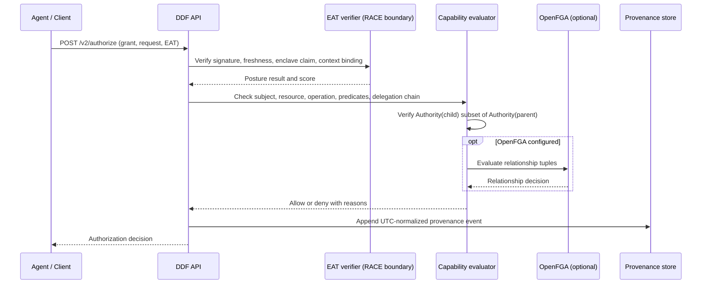

# Dynamic Delegation Fabric (DDF)


## The open-source cryptographic control plane for delegated AI agent authority

DDF is an Apache-2.0, self-hostable authorization engine for autonomous agents,
machine-to-machine (M2M) delegation, and Model Context Protocol (MCP) tool
execution. It lets an issuer grant a principal narrowly scoped authority, lets
that principal delegate only a provable subset, and evaluates each request
against signed capability data and attested runtime posture.

DDF runs locally and can authorize without a DDF-hosted cloud service. It
provides a sector-agnostic capability model: integrations supply their own
resource namespaces and policy context rather than embedding business-domain
verbs in the core assertion.

> **Standards note:** NIST SP 800-207 is an alignment reference, not a
> certification. DDF emits ACS Guardian hook envelopes under its documented
> adapter contract; the project does not claim independent OWASP ACS
> certification or conformance testing. See
> [COMPLIANCE_NIST_ACS.md](COMPLIANCE_NIST_ACS.md) for scope and limitations.

## Executive summary

### The agent authorization dilemma

Agents can invoke tools, access data, and delegate work faster than traditional
human approval flows. Long-lived credentials and broad role assignments make
it difficult to prevent privilege creep, contain a compromised agent, or
establish non-repudiable responsibility across a multi-agent workflow. A
resource server also risks becoming a **confused deputy** when it acts on an
agent's request without verifying the exact delegated authority and context.

### DDF's approach

DDF represents authority as a signed, URI-addressed capability assertion. A
delegation chain is checked for cryptographic integrity and attenuation; an
authorization request is evaluated against the leaf capability, declarative
constraints, and an EAT JWT bound to the current runtime context. Posture
failure can persistently revoke the assertion subtree and invalidate associated
OpenFGA tuples.

The design is intended to reduce exposure to privilege escalation and lateral
agent compromise while producing auditable authorization decisions. Local,
deterministic verification avoids a mandatory SaaS round trip; it does not
replace deployment-specific identity proofing, hardware evidence validation,
or resource-server enforcement. Its provenance can support assessments against
NIST SP 800-207 and HIPAA/EHR policies, but does not itself establish
compliance or certification.

## Architecture and invariants

### Core attenuation property

For every parent-child edge in a delegation chain:

$$\text{Authority}(\text{child}) \subseteq \text{Authority}(\text{parent})$$

A child assertion must retain the parent's namespace, narrow or retain the
resource scope, use only operations already granted, and provide constraints
that the evaluator can prove are no broader. If the implementation cannot prove
the constraint relation, it rejects the delegation rather than assuming
equivalence. This is a conservative, auditable subset check—not a general
theorem prover for arbitrary policy languages.

### Six dimensions of a DDF assertion

1. **Issuer and subject PEIs:** URI-based identifiers for delegator and
   delegate, such as `did:key:...`, `arn:aws:iam::...`, or an application-owned
   `urn:agent:...`. An identifier is not, by itself, proof of real-world
   identity.
2. **Target namespace and resource:** An integration-owned taxonomy and a
   resource URI, for example namespace `mcp` and resource
   `urn:mcp:tools:sql_query`.
3. **Canonical operations:** `read`, `write`, `execute`, `invoke`, `delegate`,
   and `admin`; the integration decides what an operation means for its
   resource.
4. **Declarative predicates:** JSON constraints evaluated against request
   context. DDF's built-in expression language is non-executable and
   deliberately limited.
5. **Ed25519 proof:** A detached issuer signature over DDF's deterministic
   canonical JSON representation. The signature is verified against a
   configured trusted issuer key.
6. **EAT runtime posture:** An EdDSA-signed EAT JWT, following DDF's RFC 9334
   profile, binds the request to fresh runtime context and a posture score.

DDF canonicalizes signed JSON deterministically and normalizes provenance
timestamps to UTC. The persistence and provenance tests cover both SQLite and
PostgreSQL.

### Predicate and runtime semantics

The predicate engine supports `all`, `any`, `not`, and atomic comparisons:
`eq`, `ne`, `lt`, `lte`, `gt`, `gte`, `in`, `not_in`, and `exists`. Predicates
are data, not code. For attenuation, the current implementation proves
conjunctive narrowing when parent clauses remain unchanged in the child; it
fails closed on unprovable forms.

The EAT verifier checks a trusted issuer's EdDSA signature, required claims,
token freshness, enclave assertion, posture threshold, and the SHA-256 binding
of `runtime_context`. DDF verifies the signed claims; deployments remain
responsible for validating hardware evidence and measurements before their
trusted attestation issuer issues a token. EAT claim validation is not a
substitute for a complete hardware attestation verification chain.

## Integration matrix

The core schema does not contain sector-specific action enums. These examples
illustrate integration-owned namespaces and predicate context; they are
capability fragments, not complete signed grants. See the executable profiles
in [examples/README.md](examples/README.md).

| Integration | Namespace and resource | Example operation and constraint |
|---|---|---|
| MCP / LLM tools | `mcp` / `urn:mcp:tools:sql_query` | `execute`; restrict `context.tenant_id` |
| Cloud / DevOps | `aws` / `arn:aws:s3:::example-bucket` | `read`; restrict environment and region |
| Healthcare / EHR | `fhir` / `urn:fhir:Patient/123/Observation` | `read`; require treatment basis and minimum-necessary context |
| Legal discovery | `ediscovery` / `urn:ediscovery:case/123/document/456` | `read`; require a non-privileged document in the matter |

```json
[
  {
    "target_namespace": "mcp",
    "target_resource": "urn:mcp:tools:sql_query",
    "operations": ["execute"],
    "constraints": {
      "all": [
        {"path": "context.tenant_id", "op": "eq", "value": "tenant-7"}
      ]
    }
  },
  {
    "target_namespace": "aws",
    "target_resource": "arn:aws:s3:::example-bucket",
    "operations": ["read"],
    "constraints": {
      "all": [
        {"path": "context.environment", "op": "eq", "value": "staging"},
        {"path": "context.region", "op": "in", "value": ["us-east-1", "us-west-2"]}
      ]
    }
  },
  {
    "target_namespace": "fhir",
    "target_resource": "urn:fhir:Patient/123/Observation",
    "operations": ["read"],
    "constraints": {
      "all": [
        {"path": "context.purpose_of_use", "op": "eq", "value": "treatment"},
        {"path": "context.minimum_necessary", "op": "eq", "value": true}
      ]
    }
  },
  {
    "target_namespace": "ediscovery",
    "target_resource": "urn:ediscovery:case/123/document/456",
    "operations": ["read"],
    "constraints": {
      "all": [
        {"path": "context.case_id", "op": "eq", "value": "123"},
        {"path": "context.privileged", "op": "eq", "value": false}
      ]
    }
  }
]
```

For Kubernetes, use a namespace such as `kubernetes`, a resource URI such as
`urn:k8s:namespace:staging/pods/*`, and predicates for the namespace and service
account. Predicate fields and resource ownership must be validated by the
integrating enforcement point.

## Authorization workflow



When posture falls below the configured threshold, DDF persists revocation for
the assertion and its descendants and requests deletion of their exact
OpenFGA relationship tuples. External tuple invalidation errors are surfaced;
local revocation remains persisted and authorization fails closed.

## Quick start

### Requirements and local setup

DDF requires Python 3.12 or later. SQLite is the default local database; set
`DATABASE_URL` to PostgreSQL for a server deployment. OpenFGA relationship
checks are optional and can be configured separately.

```bash
git clone https://github.com/abdirahmangg/ddf.git
cd ddf
python -m venv .venv
source .venv/bin/activate
python -m pip install -e .
alembic upgrade head
```

SQLite is the default local database. To use PostgreSQL, configure
`DATABASE_URL` before running the migration and service.

### Configure issuer trust

Before creating or delegating grants, configure the issuer URI and public key
that DDF trusts. `DDF_CAPABILITY_TRUSTED_KEYS` is a JSON object mapping issuer
PEIs to a key identifier and base64-encoded Ed25519 public key:

```bash
export DDF_CAPABILITY_TRUSTED_KEYS='{"did:web:issuer.example":{"key_id":"issuer-key-1","public_key":"<BASE64_ED25519_PUBLIC_KEY>"}}'
```

The trusted key must match the assertion proof. Protect issuer private keys
outside the DDF service; never put private keys in the trust configuration.

Create a local identity and Ed25519 key if needed:

```bash
ddf identity create did:web:issuer.example
```

This command creates a local identity record and stores its private key under
`~/.ddf/keys/` with owner-only permissions. It does not establish a PEI's
real-world identity or automatically issue a capability. Review and protect
the key file as a secret.

### Issue and delegate a grant

Create an assertion conforming to
[the universal JSON Schema](schemas/universal-ddf-capability.schema.json), then
sign it with the trusted issuer's Ed25519 key. The detached proof envelope has
this shape:

```json
{
  "assertion": {
    "grant_id": "UUID",
    "issuer": "did:web:issuer.example",
    "subject": "urn:agent:planner:7",
    "capability": {
      "target_namespace": "mcp",
      "target_resource": "urn:mcp:tools/sql_query",
      "operations": ["execute"],
      "constraints": {
        "all": [
          {"path": "context.tenant_id", "op": "eq", "value": "tenant-7"}
        ]
      }
    }
  },
  "proof": {
    "algorithm": "Ed25519",
    "key_id": "issuer-key-1",
    "signature": "<BASE64_DETACHED_SIGNATURE>",
    "public_key": "<BASE64_ED25519_PUBLIC_KEY>"
  }
}
```

The `UUID` and proof placeholders above must be replaced with actual values;
unsigned sample data is not accepted. The proof signature is over DDF's
canonical JSON serialization of the `assertion` object. See
[`Ed25519Key.sign_assertion`](src/ddf/crypto/signing.py) for the signing
interface.

```bash
ddf grant --assertion-json "$(cat signed-grant.json)"
ddf delegate \
  --parent <PARENT_GRANT_UUID> \
  --assertion-json "$(cat signed-child-grant.json)"
```

The child issuer must be the parent subject. The API verifies trusted issuer
proofs and rejects any child that expands namespace, resource, operation, or
constraints.

### Configure runtime attestation and authorize

`DDF_EAT_TRUSTED_KEYS` maps EAT issuer URIs to base64-encoded raw Ed25519
public keys. Configure the minimum posture score and maximum attestation age
for your deployment:

```bash
export DDF_EAT_TRUSTED_KEYS='{"did:web:attestor.example":"<BASE64_ED25519_PUBLIC_KEY>"}'
export DDF_MIN_POSTURE_SCORE=0.8
export DDF_ATTESTATION_MAX_AGE_SECONDS=300
export DDF_API_URL=http://127.0.0.1:8000
```

Set these variables in the server environment before starting the API:

```bash
ddf server
```

The API listens on `http://127.0.0.1:8000` by default. Keep the service behind
your trusted network boundary and configure production keys and storage before
accepting authorization traffic. Run the CLI from a second terminal with the
same `DDF_API_URL`.

An authorization request contains the current runtime context and a signed
EAT JWT issued only after the deployment's trusted attestation boundary has
validated its evidence. The JWT must bind the complete `runtime_context` using
the DDF profile's SHA-256 JSON hash. Do not use a placeholder token in
production.

```bash
ddf authorize \
  --grant <GRANT_UUID> \
  --request-json "$(cat access-request.json)"
```

`access-request.json` has this shape:

```json
{
  "subject": "urn:agent:planner:7",
  "target_namespace": "mcp",
  "target_resource": "urn:mcp:tools:sql_query",
  "operation": "execute",
  "context": {"tenant_id": "tenant-7"},
  "runtime_context": {"workload": "planner", "image_digest": "sha256:<DIGEST>"},
  "eat_token": "<SIGNED_EDDSA_EAT_JWT>"
}
```

The API endpoint is `POST /v2/authorize`. The v0.2 grant and delegation
endpoints are `POST /v2/grants` and
`POST /v2/delegations/{parent_grant_id}`. These endpoints require strict
universal assertion models and trusted issuer signatures.

### v0.1 compatibility boundary

Legacy v0.1 authority/authorization routes and fields such as `amount` and
`purpose` are deprecated. They are not fields in the v0.2 universal assertion
schema and are disabled by default:

```bash
DDF_V01_COMPATIBILITY_ENABLED=false
```

Do not enable the compatibility switch in production. Setting it to `true`
reopens the legacy unauthenticated route behavior for a controlled migration
window; it is not a v0.2 authorization mode.

## Compliance and standards alignment

| Reference | DDF control | Scope and limitation |
|---|---|---|
| NIST SP 800-207 Zero Trust Architecture | Request-time evaluation of principal, resource, operation, constraints, and runtime posture; local or optional relationship checks | Alignment mapping only. DDF does not certify a deployment or replace its reference monitor, identity proofing, or enforcement point. |
| NIST NCCoE agent identity lifecycle concepts | URI-based identities, signed authorization, execution posture, revocation, and hash-linked audit provenance | Implementation mapping, not a claim of NIST endorsement or conformance certification. Identity enrollment and evidence trust remain deployment responsibilities. |
| RFC 9334 EAT | EdDSA JWT profile with freshness, enclave claim, score, and runtime-context binding | DDF verifies its configured EAT profile; deployments must validate the underlying hardware evidence at a trusted boundary. |
| OWASP ACS v0.2 Guardian hooks | JSON-RPC 2.0 envelopes for `toolCallBefore`, `toolCallResult`, `subagentStart`, and `subagentStop`, including parent request correlation | DDF's exporter contract is documented; no authoritative ACS schema or third-party conformance suite is vendored. Validate interoperability against the ACS version adopted by your deployment. |
| SQLite and PostgreSQL | UTC-normalized, hash-linked provenance and transaction-serialized chain head | Covered by the repository's tests; operational durability, backup, access control, and retention are deployment concerns. |

See [COMPLIANCE_NIST_ACS.md](COMPLIANCE_NIST_ACS.md) for the detailed
implementation mapping and tested limitations.

## Commercial ecosystem: DDF and Arkstride MAAP

DDF is the open-source runtime engine. Arkstride MAAP is a separate commercial
enterprise control plane; it is not required to run DDF.

| Capability | DDF open-source engine | Arkstride MAAP enterprise control plane |
|---|---|---|
| License and deployment | Apache 2.0; sovereign, self-hosted, local execution | Commercial enterprise offering |
| Runtime authorization | Local capability verification, attenuation, predicates, and audit provenance | Orchestration and policy administration across managed deployments |
| Cloud dependency | No DDF-hosted cloud dependency; local verification supported | Managed control-plane services |
| Organization scope | Deployment-owned trust and integrations | Cross-organization federation and multi-tenant orchestration |
| Enterprise identity | Integrate with the deployment's identity systems | SAML and SCIM integration |
| Revocation and monitoring | Persisted local subtree revocation; optional OpenFGA invalidation | Global real-time revocation routing and continuous behavioral anomaly detection |

Use DDF where sovereign local authorization and deterministic verification
are required. Evaluate MAAP where centralized multi-tenant operations and
cross-organization control are needed. Product availability and commercial
terms for MAAP are separate from this repository.

## Governance, security, and license

- **Security disclosure:** Report vulnerabilities privately to
  [open@arkstride.com](mailto:open@arkstride.com), not in public issues. See
  [SECURITY.md](SECURITY.md).
- **Contributions:** Follow [CONTRIBUTING.md](CONTRIBUTING.md) and the
  [Code of Conduct](CODE_OF_CONDUCT.md).
- **License:** Apache License 2.0. See [LICENSE](LICENSE) and
  [NOTICE](NOTICE). “Arkstride” and “MAAP” are trademarks of Arkstride.
- **Technical references:** [Universal capability specification](docs/UNIVERSAL_CAPABILITIES.md),
  [namespace profiles](examples/README.md), and
  [NIST/ACS control mapping](COMPLIANCE_NIST_ACS.md).
